# Prototipo de alta fidelidad

El prototipo comprende doce pantallas y cubre los flujos del operario de terminal, el operario de bodega y el pasajero. Su diseño toma como referencia Material Design 3 y busca mantener visibles el estado de cada operación, los datos de la unidad y las acciones disponibles.

[Abrir el prototipo interactivo en Google Stitch](https://stitch.withgoogle.com/projects/6488328065000050213)

## 1. Inicio de sesión

Permite el ingreso de las credenciales del operario y ofrece acceso a la recuperación de contraseña.

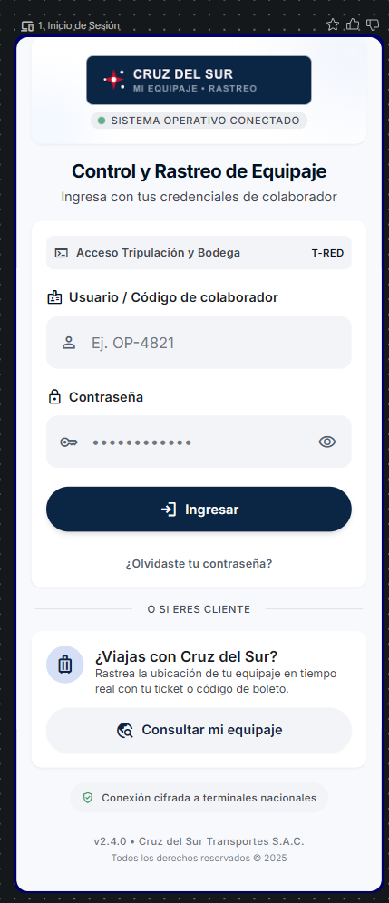

## 2. Recuperación de contraseña

Solicita el correo institucional y confirma el envío de las instrucciones de recuperación.

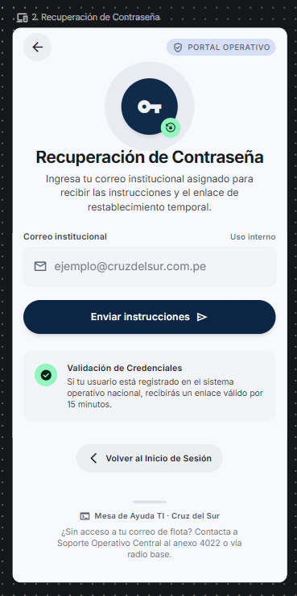

## 3. Menú principal

Presenta los módulos habilitados de acuerdo con el rol del usuario.

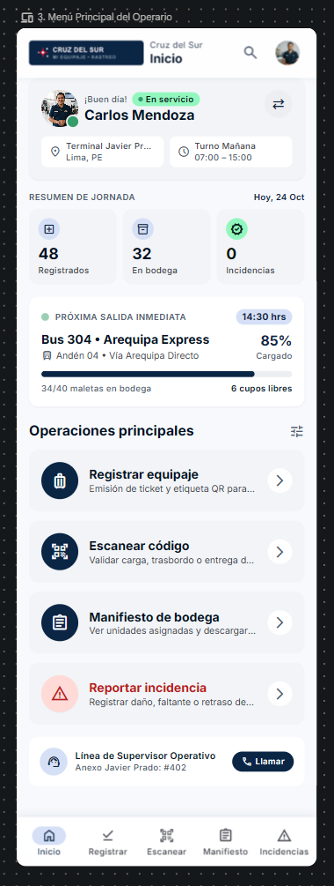

## 4. Registro de equipaje

Permite capturar los datos de la unidad y vincularla con el boleto del pasajero.

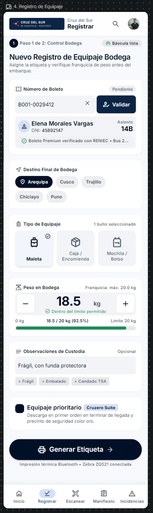

## 5. Etiqueta generada

Muestra el código único y el código QR asignados a la unidad para su impresión.

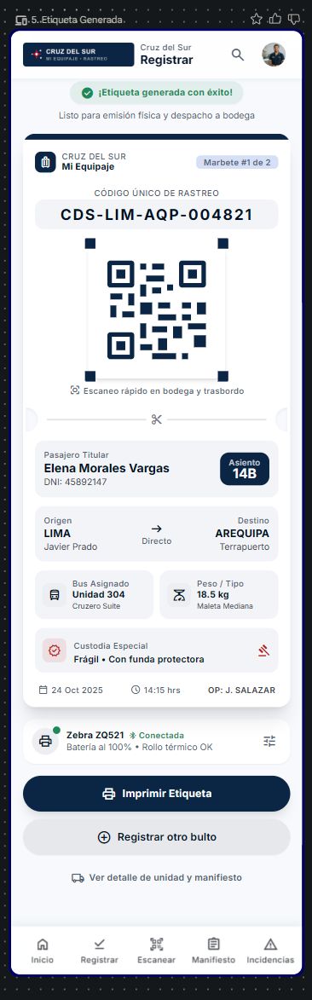

## 6. Lectura de código

Permite escanear el código QR para registrar un evento en un punto de control.

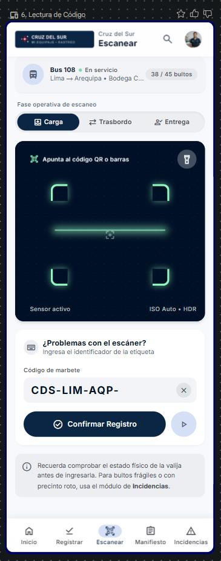

## 7. Confirmación de evento

Confirma el evento registrado e indica la fecha, la hora y el terminal.

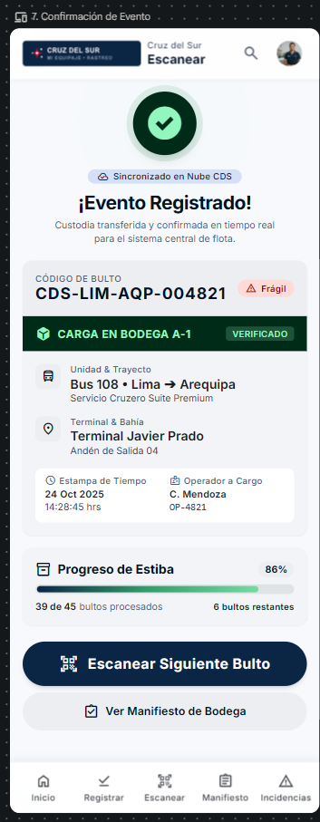

## 8. Manifiesto de bodega

Lista las unidades a bordo agrupadas por destino y facilita la identificación del equipaje correspondiente a cada escala.

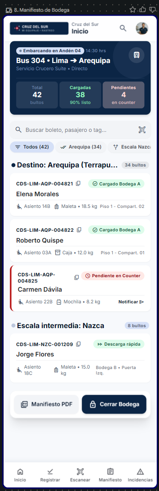

## 9. Detalle de la unidad

Presenta los datos principales del equipaje y la secuencia completa de eventos registrados.

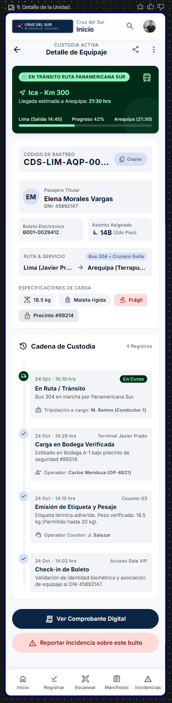

## 10. Registro de incidencia

Permite seleccionar el tipo de incidencia e ingresar una descripción de lo ocurrido.

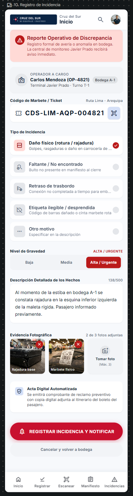

## 11. Consulta del pasajero

Solicita el código del contraste para consultar el estado del equipaje.

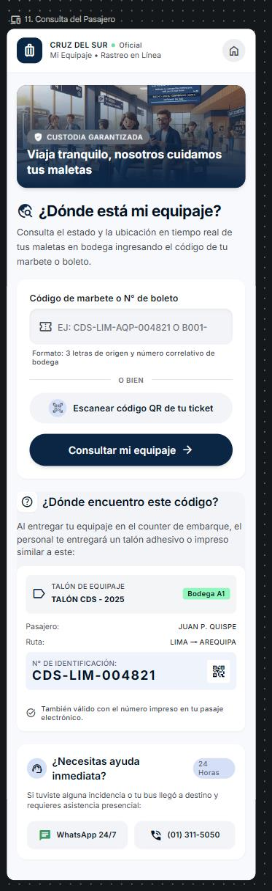

## 12. Historial del equipaje

Muestra una línea de tiempo con los eventos de control de la unidad consultada.

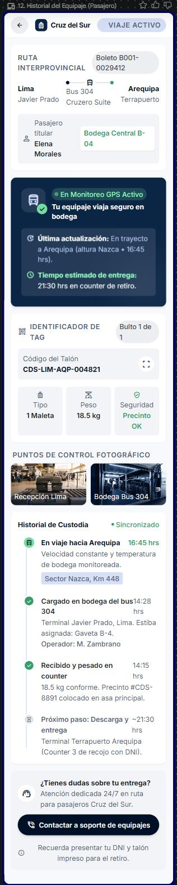
