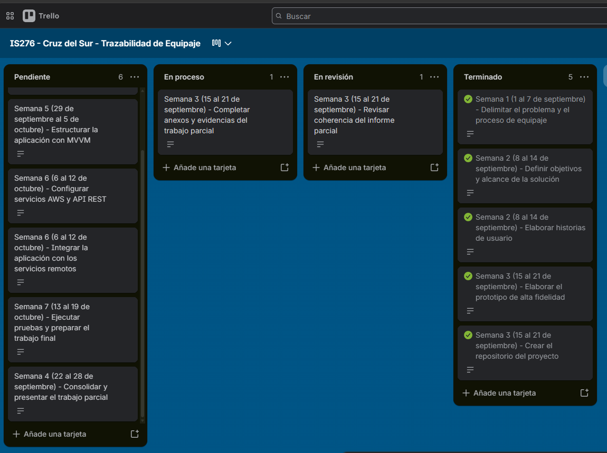

# Seguimiento del proyecto

La primera clase del curso se realizó el 1 de septiembre de 2026. Para que el seguimiento refleje el trabajo realizado de manera progresiva, el tablero se organizó con las fechas reales del curso y no únicamente con el número de semana consignado en el cronograma del informe parcial.

## Cronología de trabajo

| Periodo | Actividades principales | Estado al 21 de septiembre de 2026 |
| --- | --- | --- |
| Semana 1, del 1 al 7 de septiembre | Delimitación del problema y revisión del proceso de gestión del equipaje. | Terminado |
| Semana 2, del 8 al 14 de septiembre | Definición de objetivos, alcance e historias de usuario. | Terminado |
| Semana 3, del 15 al 21 de septiembre | Elaboración del prototipo, creación del repositorio, revisión del informe y recopilación de anexos. | En proceso y revisión |
| Semana 4, del 22 al 28 de septiembre | Consolidación y presentación del trabajo parcial. | Pendiente |
| Semana 5, del 29 de septiembre al 5 de octubre | Implementación de la interfaz con Jetpack Compose y organización de la aplicación con MVVM. | Pendiente |
| Semana 6, del 6 al 12 de octubre | Configuración de AWS, desarrollo de servicios REST e integración remota. | Pendiente |
| Semana 7, del 13 al 19 de octubre | Pruebas del flujo principal, métricas, correcciones y trabajo final. | Pendiente |

## Tablero Kanban

El tablero utiliza las listas Pendiente, En proceso, En revisión y Terminado. Las tarjetas incluyen la actividad, la semana, el resultado esperado y el responsable.

[Abrir el tablero en Trello](https://trello.com/b/sA0GRhSl/is276-cruz-del-sur-trazabilidad-de-equipaje)

La captura corresponde al estado del tablero utilizado para elaborar el trabajo parcial. El seguimiento continuará actualizándose durante la implementación y las pruebas.
